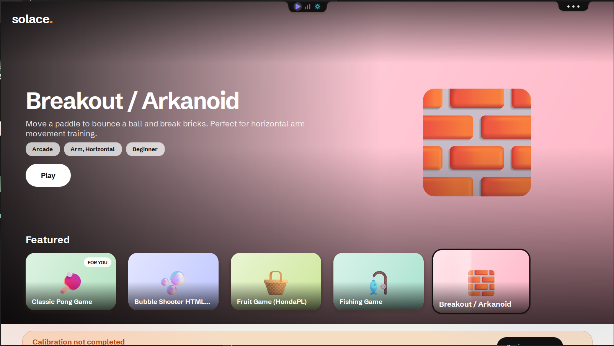

# Solace

Solace is a desktop launcher for stroke-rehabilitation games, built for a custom
wrist controller. A patient picks a game, plays it with small wrist movements,
and Solace keeps track of their range of motion, sessions and how they felt
afterwards. A therapist can export a PDF report.

It started as research software at the GAMES Lab, IIT Delhi. It is not a medical
device and has not been clinically validated. Use it for research and
experiments, not as a replacement for therapy advice.



A 25-second screen recording of the launcher is in
[docs/demo.mp4](docs/demo.mp4). GitHub plays it in the browser when you open it.

## What it does

- **Play.** A full-screen featured game that rotates through the day's
  recommended games, with the rest of the library in rows below. Games run
  inside the launcher.
- **Progress.** Sessions, day streak, minutes played against a daily goal, range
  of motion (flexion, extension, pronation, supination), a four-week activity
  grid and milestones. A PDF report can be exported.
- **Settings.** Controller calibration with a live preview, difficulty,
  accessibility, language (English and Hindi), display scale, audio and
  therapist options.
- **Profiles.** Several people can share one install. Each has their own
  history and input settings, and can lock their profile with a PIN.
- **Controller or keyboard.** Navigation works with the wrist controller, a
  gamepad or the keyboard. A short movement assessment sets a personal baseline.
- **Light and dark themes**, switched live.

## Running it

Solace needs Python 3.12 and runs on Windows. It uses PyQt6 for the interface and
pygame for the controller.

```powershell
git clone https://github.com/AyushBarua/solace-launcher.git
cd solace-launcher
python -m venv venv
venv\Scripts\pip install -r requirements.txt
venv\Scripts\python launcher.py
```

The first start shows a short setup. With no controller connected it falls back
to the keyboard (arrow keys and Enter).

### Games

The repository includes four open-source games that carry their own licence
files. Some other games that earlier builds shipped are not redistributed here
(see `CREDITS.txt`). `setup_bundled_games.py` downloads a few of them straight
from their authors' repositories:

```powershell
venv\Scripts\python setup_bundled_games.py
```

## Project layout

```
launcher.py        main window, start-up and tab handling
core/              session and profile data, controller input, reports, i18n, theme
ui/                pages (Play, Progress, Settings), top bar, navigation tab, profile panel
assets/            fonts, the 3D controller models, logo and artwork
bundled_games/     the four bundled open-source games
tests/             unit tests (pytest)
```

Data (profiles, sessions, settings) is stored locally on the machine. Nothing is
sent anywhere unless a user exports a report.

### Optional sign-in

There is an optional email and Google sign-in screen. It is switched off by
default (`REQUIRE_LOGIN = False` in `core/app_flags.py`). To use Google sign-in,
create a desktop OAuth client of your own and put its ID and secret in
`core/google_oauth.py`. The fields are empty in this repository.

## Tests

```powershell
venv\Scripts\pip install pytest
venv\Scripts\pytest tests
```

## Building an installer

`build.bat` packages the app with PyInstaller (`Solace.spec`), and
`installer.iss` builds a Windows installer with Inno Setup.

## Contributing

Issues and pull requests are welcome. If you change how the interface looks,
please include a screenshot. If you work on anything that touches patient data
or the movement assessment, say so in the pull request so it can be reviewed
with extra care.

## Licence and credits

Solace's own source code and artwork are released under the MIT licence (see
`LICENSE`).

Third-party material keeps its own licence:

- Games in `bundled_games/` and the games `setup_bundled_games.py` downloads: see
  `CREDITS.txt` for each author, repository and licence.
- Fonts in `assets/fonts/` (Parkinsans, Schibsted Grotesk, Noto Sans Devanagari):
  SIL Open Font License 1.1.
- `assets/three.min.js` and `assets/GLTFLoader.js`: three.js, MIT licence.
